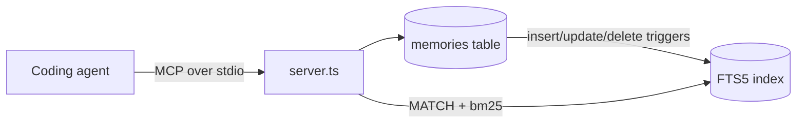

# agent-memory-sqlite

[](https://github.com/Urthella/agent-memory-sqlite/actions/workflows/ci.yml)

Persistent, searchable memory for coding agents, exposed as an [MCP](https://modelcontextprotocol.io) server. Your agent saves the decisions and conventions it learns, and recalls them in the next session instead of rediscovering them.

- **One SQLite file**, shared safely by every agent session (WAL mode)
- **Zero native dependencies**: Node's built-in `node:sqlite` with FTS5, nothing to compile on Windows, macOS or Linux
- **Ranked recall**: BM25 relevance, boosted by recency, scoped per project
- **Works with any MCP client**: Claude Code, Cursor, Claude Desktop, Windsurf

## Quick start

Requires Node 24+.

**Claude Code**

```bash
claude mcp add memory -- npx -y github:Urthella/agent-memory-sqlite
```

**Cursor / Claude Desktop** (`mcp.json` / `claude_desktop_config.json`)

```json
{
  "mcpServers": {
    "memory": { "command": "npx", "args": ["-y", "github:Urthella/agent-memory-sqlite"] }
  }
}
```

Then just work: tell the agent "remember that we deploy on Vercel", and ask "what do we know about deploys?" in a later session.

## Tools

| Tool | What it does |
|---|---|
| `remember` | Save a fact, decision or convention, with optional tags. Saving the same text again refreshes it instead of duplicating. |
| `recall` | Keyword search, best match first. Prefix matching, so `lock` finds `locks`. |
| `recent` | The latest saved or refreshed memories. |
| `forget` | Delete a memory by its `#id`. |

Every tool takes an optional `project`. It defaults to the name of the directory the agent runs in; `"*"` searches all projects.

## How it works



- **Storage**: a plain `memories` table plus an external-content FTS5 index kept in sync by triggers, so text is stored once and every write path updates search.
- **Dedup**: a SHA-256 of the text is unique per project; saving it again only bumps `updated_at`.
- **Safe queries**: free text is reduced to quoted prefix terms (`"redis"* OR "lua"*`), so punctuation and FTS operators in a question can't break the query.
- **Ranking**: the top BM25 hits are reranked by `relevance × (1 + recency)`, where recency halves every 30 days.
- **Accents**: the tokenizer folds diacritics, so `agac` finds `ağaç`.

## Configuration

| Variable | Default |
|---|---|
| `AGENT_MEMORY_DB` | `~/.agent-memory/memory.db` |
| `AGENT_MEMORY_PROJECT` | name of the current directory |

## Develop

```bash
npm ci        # also builds dist/
npm test      # node --test, runs the .ts sources directly
```

`nix develop` (or direnv) gives you the same Node 24 toolchain. CI runs on Linux, macOS and Windows.

## License

[MIT](LICENSE)
